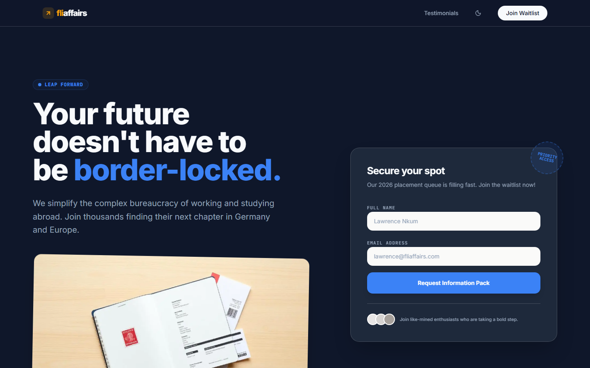

# Fliaffairs

The launch page and waitlist for Fliaffairs, a startup that helps people work and study abroad: visa guidance for Digital Nomad and Study-Work routes, job placements with companies hiring for relocation, and support after arrival.

**Live:** [fliaffairs.com](https://www.fliaffairs.com)



## Why it's built this way

The goal was to find out who wants the service before building the platform. So the site does one job: explain the offer and collect a waitlist. No database, no accounts, no admin panel yet.

## What happens when someone joins

```
Waitlist form ─► Zod check in the browser ─► POST /api/waitlist (Hono) ─► same Zod check on the server
                                                                      └─► React Email template ─► team inbox (reply-to = the person)
```

- The same `waitlistSchema` validates the form (React Hook Form) and the API, so the rules can't drift apart
- Each sign-up arrives as a formatted email, and replying goes straight to the person who signed up
- If the email can't be sent, the visitor sees a clear error instead of a false success

## Stack

Next.js 16 (App Router) · Hono · React Hook Form · Zod · TanStack Query · React Email · Nodemailer · shadcn/ui · Tailwind CSS · light and dark themes

## Run it locally

```bash
npm install
cp .env.example .env.local   # SMTP_HOST, SMTP_PORT, SMTP_USER, SMTP_PASS, SMTP_FROM, WAITLIST_TO_EMAIL
npm run dev
```

---

Built by [Collins Marfo](https://github.com/kwabena-marfo).
